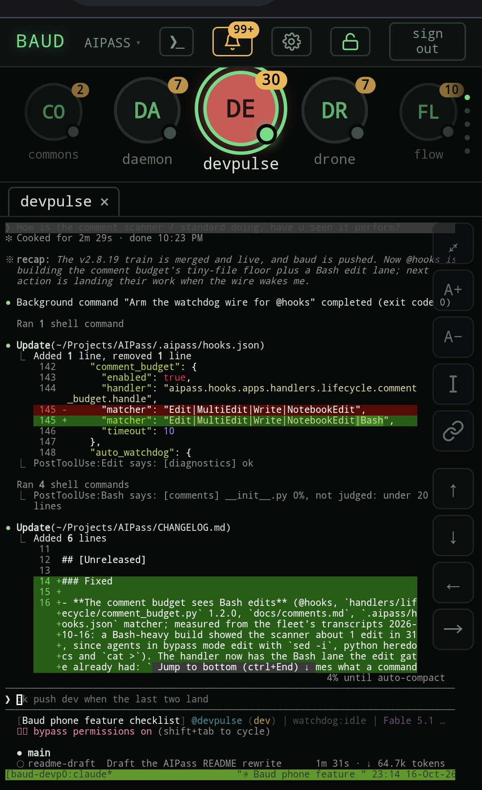
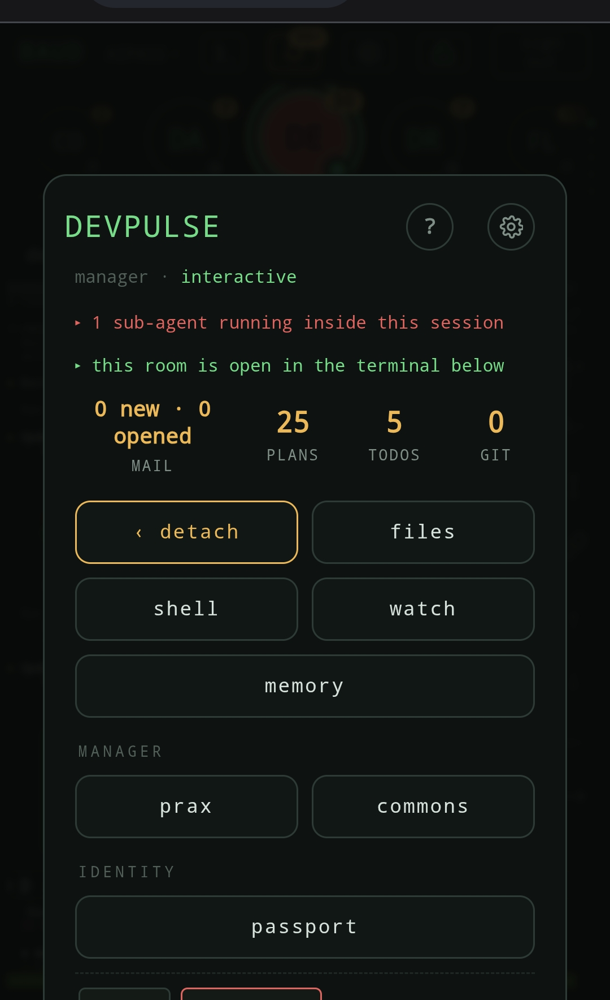

[](#project-status)
[](pyproject.toml)
[](LICENSE)
[](https://github.com/AIOSAI/AIPass/issues/new?template=feedback.yml)
[](https://codecov.io/gh/AIOSAI/AIPass)
[](https://scorecard.dev/viewer/?uri=github.com/AIOSAI/AIPass)
[](https://www.bestpractices.dev/projects/13095)
[](https://hvtracker.net/agents/aipass)

<p align="center">
  
</p>
<p align="center"><strong>An operating system for AI agents</strong></p>
<p align="center"><em>AI agents that remember, collaborate, and never start from zero.</em></p>
<p align="center">
  <a href="https://aipass.ai">aipass.ai</a> ·
  <a href="https://github.com/AIOSAI/AIPass/issues/new?template=feedback.yml">Feedback</a> ·
  <a href="https://reddit.com/r/AIPass">r/AIPass</a> ·
  <a href="https://github.com/AIOSAI/AIPass/discussions">Discussions</a>
</p>

AIPass is an operating system for AI agents. Agents live in it as citizens. Each has an identity, a memory that survives the session, a mailbox, and a home directory. They work on the same filesystem as you and each other, with no sandboxes and no worktrees, because the hooks and gates decide who may write what. You talk to one agent, say what you want built, and the fleet places the work where it belongs and does not lose track of it. Switch projects, come back a week later, and nothing has to be explained again.

BAUD is its face: a real UI, built by AIPass agents for AIPass, that presents the same functions to a human on a phone. AIPass is what everything runs on. BAUD is how you look at it.

<p align="center">
  
</p>
<p align="center"><em>BAUD on a phone: the fleet across the top, the devpulse room below with its live session, served from your own machine.</em></p>

## The Problem

When the task gets complex, you become the coordinator. You copy context between tools, dispatch work by hand, and keep track of who is doing what. You are the glue holding your AI workflow together.

Multi-agent frameworks tried to fix this. But they isolate every agent in its own sandbox. Separate filesystems. Separate context. One agent can't see what another just built. Nobody picks up where a teammate left off.

That's not a team. That's a room full of people wearing headphones.

## What Is Already Built

The boring stuff works. One human and the AIPass agents built it, and the same fleet uses it every day to build BAUD and AIPass itself.

- **Memory that persists.** Every agent remembers across sessions in plain JSON files. When those fill up, older entries roll into a local vector store you can search.
- **Mail and dispatch.** Agents send each other tasks and results, and wake whoever they are waiting on.
- **Plans that carry context.** Work is written down as a plan, so whoever picks it up knows why it exists and where it stands.
- **Gates.** Hooks decide which agent may edit which files. Git goes through one door. Raw deletes are refused.
- **Logging.** Every agent logs to its own place, and runaway logs are caught.
- **Backups with versioning.** Local snapshots you can restore from, with optional Google Drive sync.
- **Standards audits in CI.** Every agent is checked against the same standards on every change.
- **The daemon.** A scheduler runs recurring jobs, and each agent owns its own schedule.
- **A place to be.** Each agent has a home, a passport, a memory that grows with its work, and a commons where the fleet posts and gathers. Agents explore and get better at their job through experience, not retraining.
- **Everything local.** Memory and mail are files on your machine. Nothing leaves it unless you turn on an outside API, with your own keys.

Most agent frameworks separate: a worktree per agent, agents that start, finish and die. AIPass keeps disposable workers for that case (sub-agents), but its citizens persist. The framework is a context split at scale: eighteen agents today, each with its own context and memory, and a hundred would work the same way. They run in parallel, on one project or across several, and the gates keep them from colliding on the same files. The human stays the bottleneck, by design. You stay in full control, through one seat: devpulse, or your project's own manager.

## How You Use It

### 1. Install AIPass

```bash
git clone https://github.com/AIOSAI/AIPass.git
cd AIPass
./aipass install
```

This builds the environment, puts `aipass` and `drone` on your PATH, and sets up the 18 agents. It runs a health check that fixes what it can. In an interactive shell it ends in a conversation with the AIPass concierge, which greets you and walks you through what your machine still needs. On the way it may ask for your git identity (only if it is not set globally), your name, and whether the session should ask before system-changing commands. Non-interactive shells finish with defaults and no prompts. `--no-chat` skips the conversation and the health check.

Install changes a few things outside the repo, and you should know what. It adds AIPass deny rules to your user-level Claude Code settings (no raw `git commit`, `push`, `reset`, `rebase` or `config`, no reading `~/.secrets/`), and these apply to every Claude Code project on the machine. It merges its hooks with any you already have. It adds a `claude` shell function that, inside an agent directory, resumes that agent's seat. It sets `git config --global pull.rebase true` when it sets your git identity. It installs the `@anthropic-ai/sandbox-runtime` npm package if it is missing. On Linux, `sudo` may ask once to place the `/usr/local/bin` symlinks. Re-running install rebuilds `.venv`. The Uninstall section lists every file it touches.

### 2. Add it to your own project

Two ways in. `aipass new` builds a new project around a resident manager agent and makes the first commit. `aipass init run`, run inside a directory you already have anywhere on disk, does a guided setup. Both end in a conversation with your new agent.

```bash
aipass new my-project --template python   # Project + resident manager agent + git birth commit
aipass init run                           # Inside your own directory: guided setup
```

A directory outside the AIPass tree can call the fleet right away. For the fleet to send work to it, declare it once with `drone @memory roots add <path>`. Add more agents with `aipass init agent my_agent`, and check health with `aipass doctor`.

### 3. Talk to devpulse

Day to day you talk to one agent. For AIPass itself that is devpulse, the orchestrator: run `claude` inside `src/aipass/devpulse`. Say what you want in plain words, such as "Add a CSV export to the report command." Devpulse writes a plan, sends the work to the agent that owns that code, and reports back when it lands. The same steps by hand:

```bash
drone @flow create . "Add CSV export"            # Create a work plan
drone @ai_mail dispatch @agent "Subject" "Body"  # Send a task and wake an agent
drone @seedgo audit aipass                       # Run the standards checks
```

<p align="center">
  
</p>
<p align="center"><em>The same agent seen from BAUD: what it is doing right now, its mail, plans and todos, and the doors into its files, shell, memory and passport.</em></p>

**Want the face? BAUD:** its [README](projects/baud/README.md) covers what it installs, phone pairing, and security.

```sh
curl -fsSL https://github.com/AIOSAI/baud/releases/latest/download/install.sh | sh
```

> **Need help?** [Ask in Discussions](https://github.com/AIOSAI/AIPass/discussions) or [file feedback](https://github.com/AIOSAI/AIPass/issues/new?template=feedback.yml). Both take 30 seconds.

## How It Works

**One bus.** `drone @agent command [args]` reaches any agent. You use it, and agents use it to reach each other.

**One citizen shape.** Every agent, yours and the reference fleet, has the same layout. Know one and you know them all:

```
src/my_project/<agent>/
├── .trinity/           # Identity + memory (persists across sessions)
├── .ai_mail.local/     # Mailbox (receives tasks, sends results)
├── .aipass/            # Branch prompt (how this agent introduces itself)
├── apps/               # Entry point → modules → handlers
├── artifacts/          # Birth certificate + agent-produced files
├── logs/               # Per-agent logs
├── tests/              # The agent's own test suite
└── README.md           # Domain knowledge (read on startup)
```

**One owner seat.** Each project has one manager agent you steer through. Every agent can read git through the bus; only a project's manager writes to it.

**No index.** Nothing indexes your codebase. An agent finds its way the way a new colleague does: the bus, the owning agent's README, and its own memory of what it did last time.

## The Reference Implementation

AIPass ships with 18 agents that maintain and develop it. Most you never run in your own project: they are examples, and services your project can call. Each has its own README under `src/aipass/`.

```
devpulse (orchestrator: the one you talk to)
   ├── aipass   : concierge and onboarding (init, doctor, profile)
   ├── drone    : command routing and @agent resolution
   ├── seedgo   : quality standards, checked across all agents
   ├── prax     : monitoring, logs, runaway-log detection
   ├── ai_mail  : agent-to-agent mail and task dispatch
   ├── flow     : plans, templates, archival
   ├── spawn    : creates, updates and deletes agents
   ├── hooks    : hook engine and per-project config
   ├── memory   : archival, vector store, semantic search
   ├── api      : external APIs, keys and secrets, host server (optional)
   ├── trigger  : event bus, wakes the agent that owns an error
   ├── cli      : terminal formatting and output
   ├── backup   : local snapshots and restore (optional Drive sync)
   ├── daemon   : scheduler for recurring jobs
   ├── skills   : capability units any agent can run
   ├── commons  : the social space where agents post and gather
   └── canary   : test citizen, broken on purpose so working agents never are
```

## Project Status

**Stable.** Built by one human and the AIPass agents, with a handful of outside contributions. From here the work is fine-tuning.

Linux is the daily platform. macOS runs the full suite in CI on Python 3.12 and is expected to work, but is not yet in daily use. On Windows, AIPass runs inside WSL2. Native Windows is not supported.

**Version:** see [git tags](https://github.com/AIOSAI/AIPass/tags). **Agents:** 18 core + user-created.

## Requirements

- Python 3.10+
- [Claude Code](https://code.claude.com/docs)
- Linux or macOS (both tested in CI). On Windows, use [WSL2](https://learn.microsoft.com/windows/wsl/install) and install inside it: AIPass then runs as the Linux program CI tests. Native Windows and Git Bash are not tested in CI; the code keeps its Windows paths but nothing proves them.
- `sudo` access optional (Linux uses it for `/usr/local/bin` symlinks — falls back to `~/.local/bin` without it; macOS never asks)
- Node.js + npm optional (install uses them to add the `@anthropic-ai/sandbox-runtime` kernel sandbox; without them the sandbox is reported as optional and not set up, AIPass runs without it, and `aipass doctor` says how to add it later)
- API keys / OAuth optional (OpenRouter, Google — only for optional add-on integrations)

<details>
<summary>Uninstall</summary>

### Remove AIPass from a project

AIPass keeps agent state inside your project directory. To remove it:

```bash
# Remove AIPass files from your project.
# ⚠️ In a brought-your-own project, src/, README.md, CLAUDE.md, pyproject.toml
# and .gitignore may be partly or wholly YOURS (init never overwrites existing
# files) — remove only what AIPass created and review the rest by hand.
rm -rf .aipass/ .claude/ src/<project>/<agent>/     # the agent dir holds its own mailbox, memory, logs
rm -f CLAUDE.md AGENTS.md README.md *_REGISTRY.json .gitignore pyproject.toml .venv
rm -f src/<project>/__init__.py src/<project>/tests/conftest.py   # init's package stub

# If you ran the backup system, also remove its local state + the generated ignore file
rm -rf .backup/ && rm -f .backupignore
```

`.venv` in a project is a symlink to the AIPass runtime, not a copy.

The installer also writes a layer outside the project. Remove all of it to erase AIPass completely:

- `~/.claude/settings.json` — hook wiring, plus `env.AIPASS_HOME`, `env.CLAUDE_CODE_DISABLE_AUTO_MEMORY`, `env.CLAUDE_CODE_DISABLE_AGENT_VIEW`, the AIPass deny rules (git write verbs, `~/.secrets` reads) and one `ask` rule (edits under `~/.claude/`). Nothing of AIPass changes this file unseen: every write first drops a dated copy under `~/.claude/.backup/settings/` and a line in the `receipts.jsonl` beside it naming which door wrote; `aipass doctor --fix` lists the changes with a diff and asks once before writing (`--yes` for scripts), and the installer's own preflight writes once, with a receipt. Also `~/.claude/commands/memo.md`.
- `~/.claude/.backup/settings/` — those dated copies and the receipts ledger.
- `aipass`/`drone` symlinks in `/usr/local/bin` or `~/.local/bin`.
- Your shell rc (`.bashrc`/`.zshrc`/`.bash_profile`): a PATH line, `AIPASS_HOME` and `PYTHONUTF8` exports, and the `claude()` boot-shim function between the `AIPass boot shim` markers. On Windows, a `drone` wrapper in your PowerShell profile.
- `~/.aipass/` — cross-project state: the fleet registry, trust registry, commons database, admin key, skills, the BAUD phone face and `baud-cli` under `baud/`, the logs of the `aipass` CLI installed from PyPI under `system_logs/` (a clone logs under its own `system_logs/` instead), Telegram bot state (the Telegram skill is retired and switched off, but its state lands here if you turn it on).
- `~/.secrets/aipass/` if seeded.
- `git config --global pull.rebase true`, set only if install also set your identity.
- Only if a `codex` binary was on PATH at install: `~/.codex/config.toml` is rewritten.
- Only if you ran `drone @daemon install-timer`: a systemd user timer, removed by `drone @daemon uninstall-timer`.
- Only if the phone step ran (the fuller `aipass install`, which BAUD's installer uses): the host API's bind in `~/.secrets/aipass/host_api/config.json`, the hashes of pairing codes in `~/.secrets/aipass/host_api/pairings.json` once one is minted, and the `aipass-host-api.service` user unit under `~/.config/systemd/user/` (`systemctl --user disable --now aipass-host-api.service` removes it from boot).
- macOS only, when no Python 3.10+ is found and an existing Homebrew cannot provide one: a `uv`-managed interpreter under `~/.local/`. Linux with no Python 3.10+ stops the install and says so.

No cloud accounts, no external services — everything to clean up is on your machine.

### Remove a single agent

Use spawn's delete command to cleanly archive and deregister:

```bash
drone @spawn delete @agent_name          # asks for confirmation; --yes skips it
```

This copies the agent's directory to `.archive/deleted_branches/` (minus `.venv`, `.git`, caches), removes it from the registry, then deletes the original. The fleet's own core agents (spawn, drone, devpulse, the registry owner) refuse deletion.

</details>

<details>
<summary>Subscriptions & Compliance</summary>

### Use your existing subscription

AIPass runs on your **existing Claude subscription** — Pro or Max. No API keys required for core functionality. No extra costs beyond your existing subscription.

This works because AIPass runs Claude Code as an **official subprocess** — the same binary you'd run yourself in a terminal. It doesn't extract credentials, proxy API calls, or intercept tokens. Your subscription stays within the provider's infrastructure at all times.

### What AIPass does NOT do

- Extract or redirect subscription OAuth tokens
- Intercept CLI-to-provider communication
- Bypass rate limits or prompt caching
- Impersonate official CLI clients

Claude Code is proprietary but officially supports hooks and subprocess usage.

> API keys are only needed for the optional OpenRouter integration (the OpenAI SDK is used as its transport; there is no separate OpenAI provider). For server/automated deployments, API key authentication is recommended per [Anthropic's guidance](https://code.claude.com/docs/en/legal-and-compliance).

</details>
